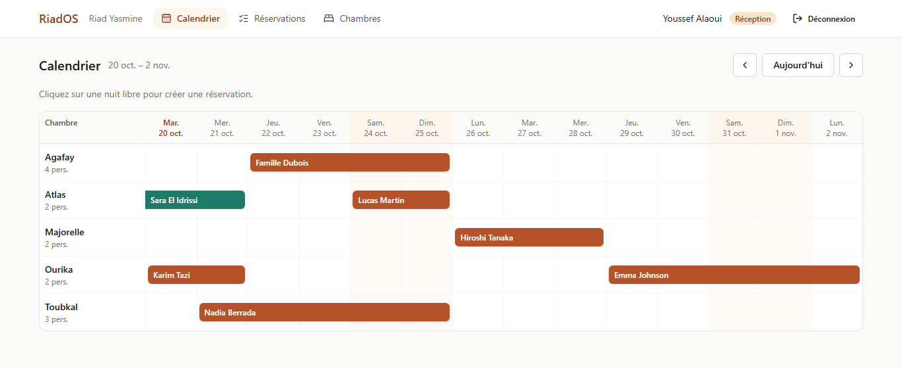
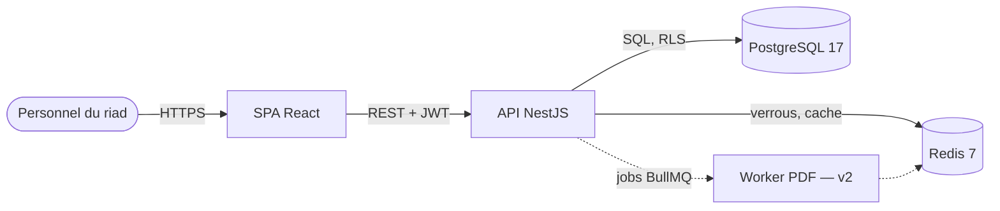

# RiadOS

[](https://github.com/KarnasZiad/RiadOS/actions/workflows/ci.yml)
[](https://github.com/KarnasZiad/RiadOS/actions/workflows/security.yml)
[](LICENSE)

**Logiciel de gestion hôtelière (PMS) SaaS multi-tenant pour les riads et maisons d'hôtes de
Marrakech** : réservations, chambres, facturation, personnel, puis synchronisation avec Booking.com
et Airbnb.

> Projet de portfolio construit comme un produit d'entreprise : conception documentée (cahier des
> charges, C4, ADR), TypeScript strict, tests unitaires et d'intégration, CI/CD et scans de sécurité.



## Sommaire

- [Points techniques](#points-techniques)
- [Architecture](#architecture)
- [Stack](#stack)
- [Démarrage rapide](#démarrage-rapide)
- [API](#api)
- [Tests et qualité](#tests-et-qualité)
- [Structure du dépôt](#structure-du-dépôt)
- [Feuille de route](#feuille-de-route)

## Points techniques

### Isolation multi-tenant par Row-Level Security

Chaque riad est un tenant. Les tables métier sont protégées par des politiques RLS PostgreSQL et
l'API se connecte avec un rôle qui n'est ni superutilisateur ni propriétaire des tables : même une
requête sans `WHERE tenant_id = ...` ne renvoie que les lignes du riad courant. Sans contexte, elle
ne renvoie rien (_fail closed_). → [multi-tenancy.md](docs/architecture/multi-tenancy.md),
[ADR 0002](docs/adr/0002-isolation-multi-tenant-par-rls.md)

### Anti-surréservation en trois niveaux

1. Verrou distribué **Redis** par chambre (`SET NX PX`, libération par script Lua vérifiant le token).
2. Transaction **`SERIALIZABLE`** qui relit les chevauchements, rejouée en cas d'échec de sérialisation.
3. **Contrainte d'exclusion** PostgreSQL `EXCLUDE USING gist (room_id WITH =, daterange(...) WITH &&)`.

Un test d'intégration lance huit réservations concurrentes de la même chambre : une seule aboutit,
avec et sans le verrou Redis. → [anti-surreservation.md](docs/architecture/anti-surreservation.md)

### Authentification

JWT d'accès de 15 minutes gardé en mémoire côté client, refresh token opaque dans un cookie
`httpOnly; Secure; SameSite=Strict` restreint à `/api/auth`, stocké haché, avec **rotation et
détection de réutilisation** (une famille compromise est révoquée en entier). Mots de passe en
**Argon2id**. → [ADR 0004](docs/adr/0004-authentification-jwt-et-rotation-des-refresh-tokens.md)

## Architecture



L'API est découpée en bounded contexts (Booking, Billing, Housekeeping). La logique métier pure vit
dans `domain/`, sans dépendance au framework. Diagrammes complets : [docs/architecture/c4.md](docs/architecture/c4.md).

## Stack

| Couche  | Technologies                                                           |
| ------- | ---------------------------------------------------------------------- |
| API     | Node.js 22, NestJS 11, Prisma 6, Zod 4, Pino, Helmet                   |
| Données | PostgreSQL 17 (RLS, `btree_gist`), Redis 7                             |
| Front   | React 19, Vite 8, TypeScript, TanStack Query, React Router, Tailwind 4 |
| Tests   | Vitest, Testing Library, Supertest, Testcontainers                     |
| Qualité | TypeScript strict, ESLint (règles typées), Prettier, Husky, commitlint |
| CI/CD   | GitHub Actions, CodeQL, Trivy, Dependabot, images Docker sur GHCR      |

Le choix des versions est expliqué dans l'[ADR 0005](docs/adr/0005-politique-de-versions.md).

## Démarrage rapide

Prérequis : Node.js 22, Docker, et pnpm via Corepack (`corepack enable`).

```bash
pnpm install
docker compose up -d                       # PostgreSQL et Redis
cp apps/api/.env.example apps/api/.env     # puis renseigner JWT_ACCESS_SECRET
pnpm --filter @riados/api db:migrate
pnpm --filter @riados/api db:seed          # riad de démonstration
pnpm dev
```

- Application web : <http://localhost:5173>
- API : <http://localhost:3000/api>
- Documentation OpenAPI : <http://localhost:3000/api/docs>

Comptes de démonstration (mot de passe `riados-demo-2026`) :

| Rôle         | E-mail                      |
| ------------ | --------------------------- |
| Propriétaire | `owner@riad-yasmine.ma`     |
| Réception    | `reception@riad-yasmine.ma` |
| Ménage       | `menage@riad-yasmine.ma`    |

Pile complète en conteneurs (front servi par Nginx sur <http://localhost:8080>) :
`docker compose --profile app up -d --build`, après avoir défini `JWT_ACCESS_SECRET` dans `.env`.

## API

| Méthode | Route                             | Rôles                   | Description                               |
| ------- | --------------------------------- | ----------------------- | ----------------------------------------- |
| POST    | `/api/auth/register`              | public                  | Crée un établissement et son propriétaire |
| POST    | `/api/auth/login`                 | public                  | Ouvre une session                         |
| POST    | `/api/auth/refresh`               | cookie                  | Rotation du refresh token                 |
| POST    | `/api/auth/logout`                | cookie                  | Révoque la session                        |
| GET     | `/api/auth/me`                    | tous                    | Profil de l'utilisateur connecté          |
| GET     | `/api/rooms`                      | tous                    | Liste des chambres                        |
| POST    | `/api/rooms`                      | propriétaire            | Crée une chambre                          |
| PATCH   | `/api/rooms/:id`                  | propriétaire            | Modifie une chambre                       |
| GET     | `/api/availability?from&to`       | tous                    | Calendrier des disponibilités             |
| POST    | `/api/reservations`               | propriétaire, réception | Crée une réservation                      |
| GET     | `/api/reservations?from&to`       | propriétaire, réception | Liste paginée par curseur                 |
| POST    | `/api/reservations/:id/cancel`    | propriétaire, réception | Annule une réservation                    |
| GET     | `/api/health`, `/api/health/live` | public                  | Readiness (PostgreSQL, Redis) et liveness |

## Tests et qualité

```bash
pnpm test:coverage       # tests unitaires, seuil de couverture à 80 %
pnpm test:integration    # PostgreSQL et Redis réels via Testcontainers (Docker requis)
```

| Niveau      | Contenu                                                                                   |
| ----------- | ----------------------------------------------------------------------------------------- |
| Unitaires   | Domaine (dates, règles, prix), services, guards, rotation des jetons                      |
| HTTP        | Contrôleurs avec Supertest : validation, rôles, cookies                                   |
| Front       | Écrans avec Testing Library : connexion, calendrier, réservation, chambres, pagination    |
| Intégration | RLS, contraintes, réservations concurrentes, absence de dérive entre migrations et schéma |

Chaque pull request passe par la CI : format, lint, typecheck, tests et couverture, build, tests
d'intégration, image Docker scannée par Trivy, CodeQL et revue des dépendances. Le processus de
revue est décrit dans [CONTRIBUTING.md](CONTRIBUTING.md).

## Structure du dépôt

```text
apps/
  api/                  API NestJS
    prisma/             schéma, migrations SQL (RLS, contraintes), seed
    src/
      config/           validation de l'environnement
      infrastructure/   Prisma + TenantDb, Redis + verrou, logs
      modules/
        auth/           JWT, refresh tokens, guards
        booking/        chambres, réservations, domain/
        health/
    test/integration/   Testcontainers
  web/                  SPA React
    src/
      lib/              client HTTP (jeton en mémoire, refresh mutualisé), dates, formats
      features/         auth, calendar, reservations, rooms
      components/       UI (style shadcn/ui) et mise en page
    nginx.conf          en-têtes de sécurité, proxy /api, cache des assets
docs/                   cahier des charges, user stories, C4, ADR
infra/                  scripts d'initialisation PostgreSQL
```

## Feuille de route

- [x] Conception : cahier des charges, user stories, C4, ADR
- [x] Socle : monorepo pnpm, TypeScript strict, lint, hooks Git, CI/CD, scans de sécurité
- [x] Multi-tenancy par RLS et authentification avec rotation des refresh tokens
- [x] Chambres, disponibilités, réservations sans surréservation
- [x] Application web : connexion, calendrier avec réservation, réservations, chambres
- [ ] Glisser-déposer dans le calendrier, gestion de l'équipe
- [ ] Facturation : factures PDF par un worker BullMQ, paiement Stripe (adaptateur CMI)
- [ ] Housekeeping : tâches de ménage, PWA hors-ligne
- [ ] Channel manager iCal (Airbnb, Booking.com), tarification dynamique
- [ ] Interface FR / EN / AR avec mise en page RTL
- [ ] Déploiement : Terraform, Traefik + Let's Encrypt, base managée

## Licence

[MIT](LICENSE) © 2026 Ziad Karnas
