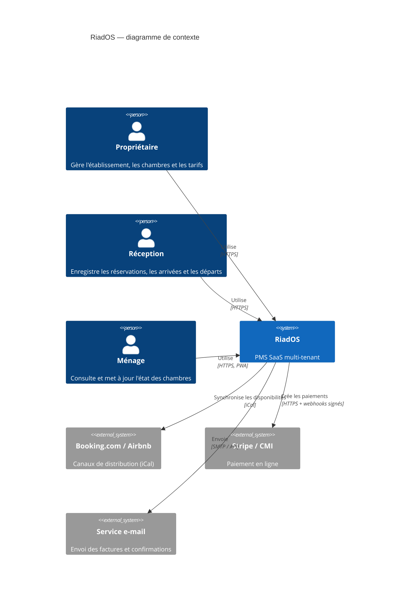
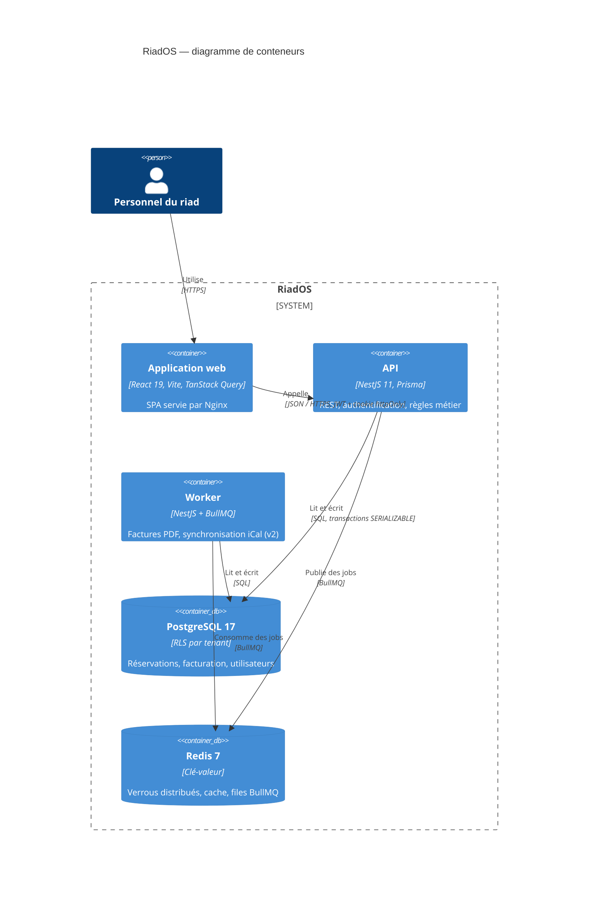
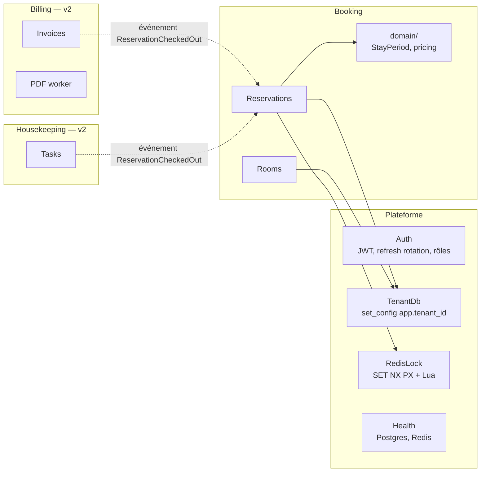

# Architecture — modèle C4

## Niveau 1 — Contexte

## Niveau 2 — Conteneurs

## Niveau 3 — Composants de l'API

L'API est découpée par **bounded context** (DDD). Chaque contexte possède son module NestJS ; la
logique métier pure (objets valeur, calcul de prix) vit dans un dossier `domain/` sans dépendance au
framework, ce qui la rend testable unitairement.

Les contextes Billing et Housekeeping ne dépendent pas directement de Booking : ils réagiront à des
événements de domaine (`ReservationCheckedOut`) publiés dans une file BullMQ.
