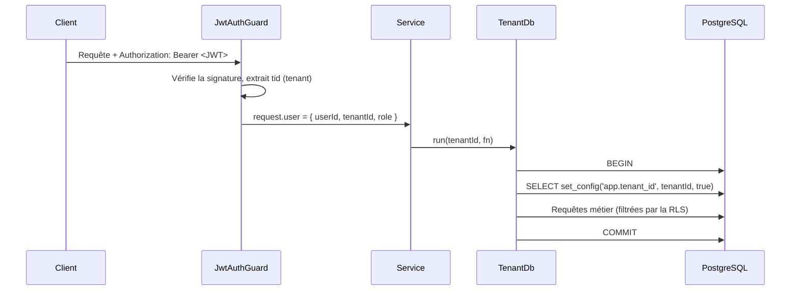

# Multi-tenancy par Row-Level Security

Chaque riad est un **tenant**. Toutes les tables métier portent une colonne `tenant_id` et sont
protégées par une politique RLS PostgreSQL. L'isolation ne repose donc pas uniquement sur le fait de
ne pas oublier un `WHERE tenant_id = ?` dans le code : la base refuse de renvoyer ou d'écrire une
ligne d'un autre tenant.

## Rôles PostgreSQL

| Rôle                   | Usage                                     | Soumis à la RLS |
| ---------------------- | ----------------------------------------- | --------------- |
| `riados_owner`         | Propriétaire du schéma, migrations        | Non             |
| `riados_app` (NOLOGIN) | Rôle de privilèges créé par la migration  | Oui             |
| `riados_api` (LOGIN)   | Utilisé par l'API, membre de `riados_app` | Oui             |

L'API ne se connecte jamais avec le propriétaire des tables : un propriétaire contourne la RLS, sauf
avec `FORCE ROW LEVEL SECURITY`, et un superutilisateur la contourne toujours.

## Politique appliquée

```sql
ALTER TABLE rooms ENABLE ROW LEVEL SECURITY;
ALTER TABLE rooms FORCE ROW LEVEL SECURITY;

CREATE POLICY tenant_isolation ON rooms
  USING (tenant_id = NULLIF(current_setting('app.tenant_id', true), '')::uuid)
  WITH CHECK (tenant_id = NULLIF(current_setting('app.tenant_id', true), '')::uuid);
```

- `USING` filtre les lectures, mises à jour et suppressions.
- `WITH CHECK` empêche d'insérer une ligne pour un autre tenant.
- `NULLIF(..., '')` : sans contexte, la politique compare à `NULL` et ne renvoie **aucune** ligne
  (comportement « fail closed ») au lieu de lever une erreur de conversion.

## Propagation du tenant



`set_config(..., true)` limite la variable à la transaction courante : elle disparaît au `COMMIT`.
Une connexion rendue au pool ne transporte donc jamais le tenant de la requête précédente.

## Tables de plateforme

`tenants`, `users` et `refresh_tokens` ne sont pas soumises à la RLS : la connexion d'un utilisateur
se fait avant de connaître son tenant. L'accès à ces tables est restreint au module `auth`, et le
tenant de l'utilisateur est ensuite porté par son JWT.

## Défense en profondeur

Les services filtrent quand même explicitement par `tenantId`. La RLS est le filet de sécurité, pas
la seule protection. Les tests d'intégration vérifient les deux niveaux.
