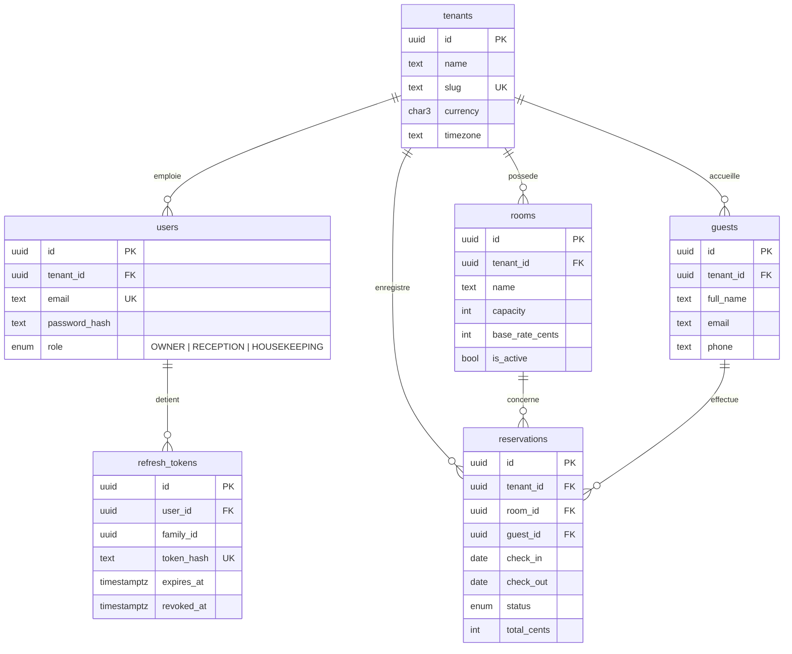

# Modèle de données

Schéma géré par Prisma (`apps/api/prisma/schema.prisma`). Les éléments que Prisma ne sait pas
exprimer (RLS, contrainte d'exclusion, rôles) sont ajoutés en SQL dans la migration initiale.

## Index

| Table            | Index                              | Requête servie                                 |
| ---------------- | ---------------------------------- | ---------------------------------------------- |
| `reservations`   | `(tenant_id, check_in, id)`        | Liste paginée par curseur sur une période      |
| `reservations`   | `(tenant_id, room_id, check_in)`   | Disponibilités d'une chambre                   |
| `reservations`   | GiST `(room_id, daterange)`        | Contrainte d'exclusion anti-chevauchement      |
| `rooms`          | unique `(tenant_id, name)`         | Unicité du nom d'une chambre par établissement |
| `guests`         | `(tenant_id, full_name)`           | Recherche d'un client                          |
| `refresh_tokens` | unique `token_hash`, `(family_id)` | Rotation et révocation d'une famille de jetons |

## Conventions

- Clés primaires UUID : pas d'identifiant séquentiel devinable exposé dans les URL.
- Montants en centimes (`int`) : pas d'erreur d'arrondi des flottants.
- Dates de séjour en `date` (sans heure) : une nuit est une date, indépendante du fuseau horaire.
- Horodatages en `timestamptz`.
